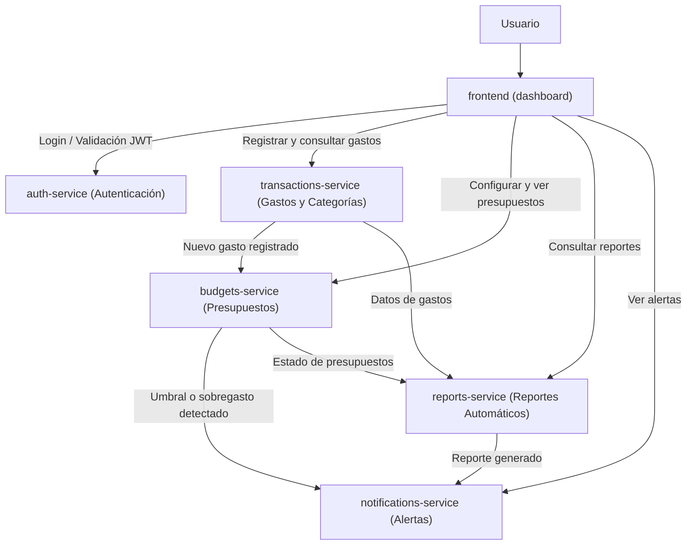

# Billetera

**Billetera** es una plataforma de finanzas personales para uso individual diseñada para facilitar el control financiero diario. Permite gestionar el registro y categorización de gastos, definir presupuestos personalizados, recibir alertas de sobregasto en tiempo real y obtener reportes automáticos sobre el comportamiento financiero.

---

## Estructura del Monorepo y Microservicios

El proyecto está organizado como un monorepo donde cada servicio es independiente y reside en su propia carpeta en la raíz del repositorio:

```text
billetera/
├── frontend/               # Dashboard web principal
├── auth-service/           # Autenticación y gestión de sesión
├── transactions-service/   # Registro y categorización de gastos
├── budgets-service/        # Gestión y seguimiento de presupuestos
├── notifications-service/  # Alertas de sobregasto y notificaciones
├── reports-service/        # Generación de reportes automáticos
└── README.md
```

### Propósito de cada componente

| Servicio / Carpeta | Rol | Descripción |
| :--- | :--- | :--- |
| **`frontend`** | Dashboard | Interfaz de usuario (UI) desde donde el usuario visualiza su resumen financiero, registra gastos, configura presupuestos, consulta reportes y administra sus alertas. |
| **`auth-service`** | Autenticación | Gestiona el registro, inicio de sesión, emisión/validación de tokens (JWT) y control de acceso para asegurar las operaciones del usuario. |
| **`transactions-service`** | Gastos y Transacciones | Permite registrar, editar, consultar y categorizar los movimientos o gastos individuales, notificando a otros servicios cuando ocurren nuevos cargos. |
| **`budgets-service`** | Presupuestos | Administra los límites de gasto por categoría o período. Evalúa el consumo acumulado frente al presupuesto definido para detectar umbrales o sobregastos. |
| **`notifications-service`** | Alertas | Envía notificaciones y alertas de sobregasto al usuario cuando un presupuesto está próximo a agotarse o ha sido superado, así como avisos de nuevos reportes. |
| **`reports-service`** | Reportes Automáticos | Consolida datos de transacciones y cumplimiento de presupuestos para generar resúmenes periódicos y análisis financieros automáticos. |

---

## Diagrama de Arquitectura

El siguiente diagrama ilustra la interacción principal entre el frontend (`dashboard`) y los microservicios del backend:

